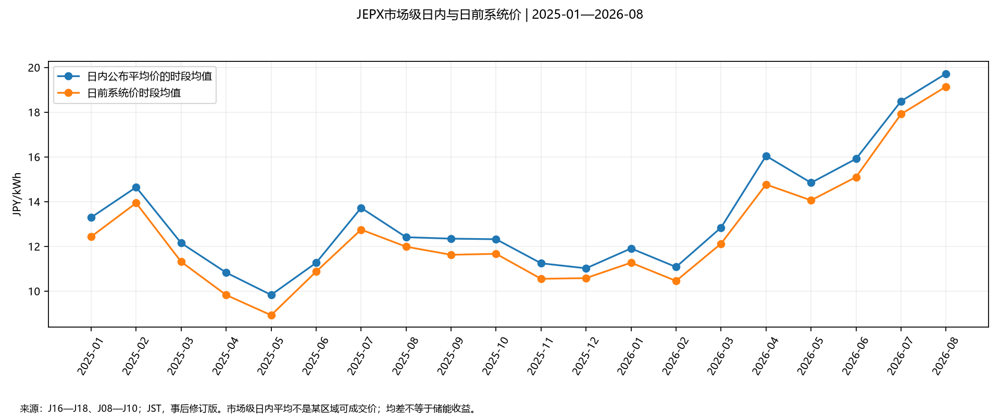
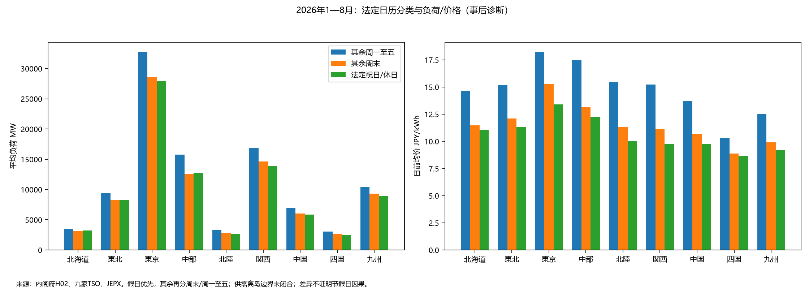

# 第二轮问题修复与复核提交

2026-09-28研究，2026-09-29（JST）整合送审。信息截止仍为2026-09-28，历史期不变。上一轮审核NOT_PASS保留在review_record.md，上一轮主要交付快照保存在review_round1/。本文件描述本次实质修订；问题是否关闭由Astra high独立判断。

## R02—R05：边界、装机与历史条款

[边界与装机修订](../topics/boundary_revision_20260928.md)补充各区岛屿边界证据、东京及九州逐岛已连接可再生容量。岛屿清单不等于已经取得九区全部岛屿的全燃料装机和分时负荷，仍不能扣除或假设为零。九州pc.html仅证明其页面PV实绩含离岛，TS09月度CSV仍是unknown。

M04原始工作簿已成功取得：2025财年METI府县统计，12张月表至2026年3月，公表标记2026-09-11。附件按明确府县行号、列号复算九组主要燃料MW及2025年4月到2026年3月变化；主线程重算与附件一致。府县代理既不是精确TSO边界，也未排除离岛，更不是2026年8月31日断面。OCCTO O11图3-3另给出财年末PV/风电展望，已修正财年、MW换算及北陆/关西风电转录，不把计划当实绩。

[历史规则与结算修订](../topics/history_settlement_revision_20260928.md)对E36/E37/E38/E34/E35/E02六段EPRX原规程比较采购、产品、资源计量及费用条款。此附件是有限条款核对，不等于所有JEPX、EPRX罚则、BG合同与容量合同的完整连续历史链。资源分摊公式、历史离线框及属地BG接口的未闭合项继续保留。主线程要求所有引文明确PDF页序，禁止用约数或印刷页冒充PDF页。

## R07：日内数据和区域费用

找到并成功下载JEPX官方im_trade_summary_2024/2025/2026.csv（J16—J18），完整覆盖29,184个半小时，字段结构、重复、缺失和OHLC边界检查通过。旧PHP空返回及404仍保留为采集尝试，不再据此声称日内数据不可取得。

|样本|日内公布平均价的时段均值|日前系统价时段均值|同一时段日内减日前均差|差值P05/P95|
|---|---:|---:|---:|---:|
|2025全年|12.0739|11.3560|0.7179|−1.58 / 3.59|
|2025年1—8月|12.2469|11.4825|0.7644|−1.63 / 3.75|
|2026年1—8月|15.1457|14.3945|0.7512|−3.32 / 5.4485|

单位JPY/kWh；均值按半小时时段算术平均，保留源文件“平均”字段，不另称全市场成交加权年均价。原量字段约定量合计单位为MWh/h，保留原值与单位，未擅自与网页kWh标签互换；时间段最高最低价差不是可执行收益。无区域交易标签、逐笔成交时间/方向/订单簿，不能将市场级日内均价逐区复制做真实成交价。

九区发电侧费率快照、储能电量豁免、计费对象功率及未齐成本见[区域费用修订](regional_cost_revision.md)。E41—E43历史需求ZIP共285个CSV成员已逐个登记哈希；它们是需求量，不是中标量/价格或激活时序。E39还明确扣除量超过必要量时MMS必要量为0，扣除后一次募集量低于离线框时离线落札量以上述募集量为上限；不能拿某个历史年度恒定需求代替每日可获份额。

从E43的`2026_Requirement_20260309(20260401).csv`另提取2026年4—8月5类商品（复合/一次/二次①/二次②/三次①）、48时段、九区共10,800个需求模板值及225组统计，保存为`requirement_template_2026_AprAug_v20260309.csv`。严格固定2026-03-09公布版本，不拼接ZIP中2026-09-04更新到历史决策。它不是逐日实绩，未展开成每天相同需求，也不是一次离线框。以8月一次为例，九区日模板均值MW分别为北海道61.7、东北186.7、东京668.6、中部240.3、北陆58.8、关西280.6、中国145.7、四国43.1、九州171.9；只用于采购需求尺度比较。

## R10：法定节假日与有官方证据的事件

内阁府H01/H02已归档。逐日分类优先级为法定祝日/休日（包括振替休日）→其余周六周日→其余周一至周五。2025全年分别19/100/246日；2026年1—8月分别12/69/162日。此处Workday是研究日历分类，不代表每个企业的实际营业日；盂兰盆、企业年末停工等未擅自视为法定假日。

`calendar_JST.csv`、`daytype_statistics_DIAGNOSTIC.csv`和更新后的月度典型日底表包含完整日历映射。以2026年1—8月为例，东京Workday/Weekend/National-holiday均价为18.213/15.310/13.392；九州为12.505/9.914/9.194JPY/kWh。对应区域负荷表仍有离岛边界限制，不把不同季节混合的日类差异解释为纯节假日因果效应。

**官方事件事实：**OCCTO EV01/EV02（2025-08-27）验证2025年4—6月九州本土50个再能抑制日，选择4/13、4/17、5/4、5/25、6/1五个代表日。EV01 p3明确排除离岛；EV02 p1分别列出对应参考时段前日计划抑制需要量4,866/2,690/4,941/4,393/4,278MW。该计划量不是全日实际抑制电量。

|代表日|源TS09全日光伏抑制MWh（诊断）|九州日前均价|0.01及以下半小时时段|
|---|---:|---:|---:|
|2025-04-13|23,085.5|6.645|15|
|2025-04-17|5,781.5|7.469|11|
|2025-05-04|31,891.5|6.203|18|
|2025-05-25|4,457.5|3.964|18|
|2025-06-01|24,205.5|4.717|19|

**解释：**5/4低负荷、光伏抑制与大量价格下限时段同时出现，但5/25实际抑制电量更低、日均电价反而更低，表明不能用抑制量单变量推导市场价。官方事件本土边界不能自动证明TS09整条历史CSV同口径。统计见`event_comparison_DIAGNOSTIC.csv`；未完成机组检修、燃料、水文及全部跨区事件的因果归因。

## R06与R09：合同和证据

新增[容量机制修订](capacity_mechanisms_revision.md)：普通2026追加拍卖履约/罚款、Z=90小时修改框；长期2025约款第28条95%/90%/85%分段返还与重叠优先、收益基数和税例外。保留期待容量系数和完整历史合同适用缺口，不将公开规则缺口混同为用户缺合同。

E23封面日期2025-06-19、J05末次改定2023-08-04已核定；新增来源进入证据目录，失败请求不算成功归档。所有新计算仅为描述性研究，未运行策略、MILP或收益回测。

## 本轮交付与核验索引

|类别|新增/更新文件|
|---|---|
|主交付|research_report.md、model_handoff.md、README.md；本轮revision_round2.md；上一版快照review_round1/|
|公开合同与费用|capacity_mechanisms_revision.md、regional_cost_revision.md|
|边界与历史专题|countries/JP/topics/boundary_revision_20260928.md、history_settlement_revision_20260928.md；countries/JP/data/raw/enecho_ep002_2025_1-2.xlsx（不可覆盖）|
|数据与分析|intraday_30min_JST_expost.csv、intraday_statistics.csv、calendar_JST.csv、daytype_statistics_DIAGNOSTIC.csv、event_comparison_DIAGNOSTIC.csv、requirement_archive_inventory.csv、requirement_template_2026_AprAug_v20260309.csv、requirement_template_statistics.csv；均在analysis/|
|同步派生数据|fundamentals_30min_DIAGNOSTIC.csv、monthly_daily_profiles_DIAGNOSTIC.csv增加日类型；其余统计随同重新生成，原始证据未覆盖|
|图表|figures/holiday_comparison_DIAGNOSTIC.png、intraday_vs_DA_system.png；O13 p52、O20 p25、EV02 p1原文渲染已视觉核对|
|证据|sources.jsonl、evidence_register.md、source_inventory.csv；新增不可覆盖原文位于evidence/，H01/H02/E34—E46/J16—J18/O17—O20/EV01—EV02等|
|复现与检查|analyze_history.py、analyze_revision.py、plot_revision.py、build_register.py、validate_package.py、fetch_official.py及本轮batch15—19.json；研究处理程序，不是MILP生产代码|
|审核|review_record.md追加本轮实际独立结论；此前NOT_PASS记录保留|

首次送审20项检查通过；R11修正后主线程核验已通过21项数据/算术完整性检查（validation_report.md），289个非空源文件哈希一致；新增府县代理63个数值与M04复算一致。新需求模板未伪装为成交，日内市场级平均未伪装为逐区可执行价格。事实取自JEPX、EPRX、OCCTO、METI/监管委员会、内阁府及TSO；事件解释和现金流算术示例均明确标注，不作为市场规则或真实收益。

本轮整包独立审核已返回NOT_PASS，R09原日期问题/R10原日历事件问题修复通过，新增R11/R12已修正并针对性复核；实际结论见[本轮审核记录](review_round2_result.md)。
